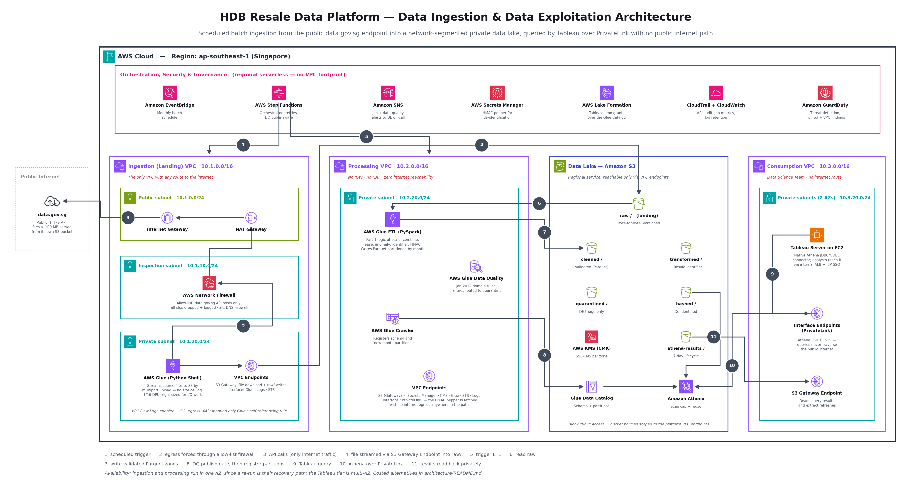

# Part 2 — Data Ingestion & Data Exploitation Architecture (AWS)



Operationalising the Part 1 pipeline: scheduled batch ingestion from the public data.gov.sg
endpoint into a network-segmented private data lake, and private query access for the Data
Science Team's Tableau deployment.

### Files

| File | What it is |
|---|---|
| `data_platform_architecture.png` | The submitted diagram image |
| `data_platform_architecture.drawio` | The same architecture as an **editable draw.io file** — open in [diagrams.net](https://app.diagrams.net) (File ▸ Open) or the VS Code *Draw.io Integration* extension |
| `generate_diagram.py` | Renders the PNG |
| `generate_drawio.py` | Renders the `.drawio` |
| `aws_icons.py` | Shared: downloads + caches the official AWS icon pack |

Both renderings use the official
[AWS Architecture Icons](https://aws.amazon.com/architecture/icons/) and encode the same design.
The icon pack is downloaded and cached on first run (gitignored), the same idempotent pattern
Part 1 uses for source data, so both are reproducible from a fresh clone:

```bash
pip install -r requirements.txt
python architecture/generate_diagram.py   # PNG
python architecture/generate_drawio.py    # editable draw.io
```

In the `.drawio` file the AWS icons are embedded directly rather than referenced through
draw.io's own shape library, so it renders identically in any draw.io version while staying
fully editable (boxes, labels, arrows and layout are all native mxGraph elements).

---

## 1. How the design meets each requirement

| # | Requirement | How it is met |
|---|---|---|
| 1 | Batch ingestion from data.gov.sg | EventBridge Scheduler → Step Functions → AWS Glue Python Shell job, on a monthly cadence matching HDB's publication rhythm |
| 1 | Files > 100 MB | The ingestion job **streams** each file into S3 by multipart upload. Nothing is held in memory or on local disk, so file size is not a design constraint — the pattern is the same for a 20 MB or a 20 GB file. The large transfer also never touches the internet: data.gov.sg serves files from its own S3 bucket in the same region, so they travel through the S3 Gateway Endpoint |
| 1 | Complex data engineering | Glue (PySpark) runs the full Part 1 rule set — combine, profile, validate/quarantine, remaining lease, anomaly heuristics, Resale Identifier, HMAC de-identification — with Glue Data Quality expressing the Jan-2012 authoritative domain rules declaratively |
| 2 | Public endpoint vs. private VPCs | Three separate VPCs by function (ingestion / processing / consumption). **Only the Ingestion VPC has any route to the internet**; Processing and Consumption have no IGW and no NAT at all |
| 2 | Network + component segmentation | Internet-bound traffic is forced through a dedicated inspection subnet running AWS Network Firewall, which allows only data.gov.sg's two API hosts: `api-production.data.gov.sg` (dataset discovery) and `api-open.data.gov.sg` (downloads). A cost-optimised alternative is in §4. The job that touches the internet can write **only** to `raw/` and cannot read any curated zone; the job that holds curated data cannot reach the internet. A compromise of the internet-facing component yields no curated data |
| 3 | Tableau querying the data lake | Amazon Athena over the Glue Data Catalog, via Tableau's native Athena JDBC/ODBC connector — query-in-place, no copy of the lake into a separate warehouse |
| 4 | Private traffic where possible | Every AWS hop uses a VPC endpoint: Gateway Endpoints for S3, Interface Endpoints (PrivateLink) for Athena, Glue, STS, Secrets Manager, KMS and CloudWatch Logs. **No platform data crosses the public internet in either direction.** The only internet hop is the small `poll-download` API call; the file itself arrives over the S3 Gateway Endpoint |

---

## 2. Network segmentation — the core of the security design

The brief calls out the public/private boundary explicitly, so the design treats it as the
primary structuring principle rather than an afterthought:

**Ingestion (Landing) VPC — `10.1.0.0/16`** — the only tier with internet reachability.
- *Public subnet*: IGW + NAT Gateway. No workload runs here. Like the rest of the batch
  tiers, it is single-AZ (see §4 for why).
- *Inspection subnets*: AWS Network Firewall. All internet-bound traffic from the private
  subnets is routed through it, and the allow-list permits only data.gov.sg's two API hosts:
  `api-production.data.gov.sg` (dataset discovery) and `api-open.data.gov.sg` (downloads). Anything else is dropped and logged, so a compromised job cannot send
  data to an arbitrary host.
- *Private subnets*: the Glue ingestion job. No public IP, egress on :443 only, and no inbound
  rule except the self-referencing one AWS Glue requires on a connection's security group (it
  admits traffic only from members of that same group, so nothing outside can reach the job).
  Its IAM role can write `raw/` and nothing else. The job's own AWS API calls (Glue, CloudWatch
  Logs, STS) go through interface endpoints in this VPC, not through the firewall. Otherwise the
  single-host allow-list would block them, or have to be widened to `*.amazonaws.com`, which
  would defeat its purpose.

**One easily missed detail: the S3 Gateway Endpoint policy must grant read on data.gov.sg's
bucket.** The `poll-download` API answers with a presigned URL on data.gov.sg's own S3 bucket
(`table-downloads-ingest.data.gov.sg`, ap-southeast-1) — visible in the Part 1 ingest code's
API responses. A gateway endpoint carries *all* in-region S3 traffic, including to buckets in
other accounts. So a policy written to allow only HDB's own buckets — the natural default —
would **make every download fail**. The ingestion VPC's endpoint policy therefore allows:
`s3:GetObject` on `arn:aws:s3:::table-downloads-ingest.data.gov.sg/*`, `s3:PutObject` on
HDB's `raw/` prefix, and nothing else. It also means the large transfer never goes through the
firewall or NAT — more private and cheaper — and the firewall only ever sees the small API
call.

**Processing VPC — `10.2.0.0/16`** — no IGW, no NAT, no internet route whatsoever. The Glue ETL
job reaches S3, Secrets Manager, KMS, Glue, STS and CloudWatch Logs exclusively through VPC endpoints. This is
where the HMAC pepper is used, and it is deliberately the tier with zero internet reachability.

**Consumption VPC — `10.3.0.0/16`** — Tableau Server on EC2, no internet route. Reaches Athena
and Glue over PrivateLink and the results bucket over an S3 Gateway Endpoint.

**Why three VPCs rather than one with subnet tiers**: it makes the blast radius explicit at the
routing layer rather than relying only on IAM. The tier holding curated and quarantined data has
no path to the internet *by construction* — not by policy that could be misconfigured later.

**No VPC peering is required between them.** Everything they share (S3, Athena, Glue Catalog,
Secrets Manager, KMS) is a regional service reached through each VPC's own endpoints, so the
three VPCs have no network reachability to one another at all. That is a stronger posture than
peering them and then restricting with security groups.

**Defence in depth beyond the network layer:**
- S3 bucket policies restrict access by `aws:SourceVpce`, so a leaked credential used from
  outside the platform's endpoints is still denied.
- Block Public Access account-wide; SSE-KMS with a customer-managed key per zone; `aws:SecureTransport`
  denies on every bucket.
- Least-privilege roles per stage (ingest: write `raw/` · ETL: read `raw/`, write curated ·
  Tableau: read-only on `cleaned/`, `transformed/`, `hashed/` and the results bucket).
- **The Data Science Team never gets `raw/` or `quarantined/`** — quarantine is a data engineering
  triage surface and may contain the records most likely to be malformed or sensitive.
- Lake Formation for table/column-level grants, VPC Flow Logs, CloudTrail, GuardDuty.

---

## 3. Data flow (numbered to match the diagram)

**Ingestion**
1. EventBridge Scheduler triggers the Step Functions state machine on the batch schedule.
2. The Glue ingestion job's internet-bound traffic goes through the inspection subnet. Network
   Firewall allows only data.gov.sg's two API hosts, then NAT → IGW.
3. The job discovers collection 189's datasets through the metadata API, picks those
   covering the scope, and calls `poll-download` for any not already landed. These small API
   requests are the platform's only outbound internet traffic. The API returns a short-lived presigned URL on **data.gov.sg's
   own S3 bucket** in ap-southeast-1.
4. The job streams the file from that URL straight into `raw/`. Both the read and the write go
   through the Ingestion VPC's **S3 Gateway Endpoint**. A gateway endpoint carries all in-region
   S3 traffic, including to buckets owned by other accounts. So the large transfer never
   crosses the firewall, the NAT, or the internet.
5. Step Functions triggers the ETL stage in the Processing VPC.
6. Glue ETL reads `raw/`.
7. It writes `cleaned/`, `transformed/`, `quarantined/` and `hashed/` as Parquet partitioned by
   month, pulling the HMAC pepper from Secrets Manager over PrivateLink.
8. **Publish gate**, then publish. Step Functions runs the data-quality gate (below). Only if
   it passes does the Glue Crawler register the new month partitions in the Data Catalog —
   which is the moment the data becomes visible to Athena and Tableau.

**Exploitation**
9. An analyst's Tableau query goes to the Consumption VPC's Interface Endpoints.
10. It reaches Athena over PrivateLink; Athena resolves schema from the Glue Data Catalog and
    scans only the curated zones it is authorised for.
11. Results land in `athena-results/` and are read back through the S3 Gateway Endpoint — again,
    without touching the public internet.

Step Functions publishes run failures and publish-gate failures to SNS for the data
engineering on-call.

### The data-quality publish gate

Part 1 showed why this is needed. Its output reconciles perfectly — cleaned + quarantined =
combined — yet Mar–May 2012 are **entirely missing** from the cleaned data, because HDB
published those months in 5-storey bands that the Jan-2012 rule rejects. Totals can't reveal a
time-series hole. In an operational pipeline, nobody would notice until an analyst's chart
showed a three-month cliff.

So between "ETL finished" and "data visible to Tableau" there is a gate. It's a lightweight
Glue Python Shell step running the same `src/completeness.py` logic as the Part 1 notebook,
plus the Glue Data Quality ruleset results:

| Check | Fails when | Grounded in Part 1 data |
|---|---|---|
| Per-month retention | A month keeps < 50% of its source rows | Mar–May 2012 retained 0% |
| Run quarantine rate | A new month's quarantine rate exceeds 5% | Steady-state months run 0.2–2.9% |
| Source shape | The authoritative slice or any domain comes back empty | The guard in `build_authoritative_domains` |
| Row volume | A month's source row count drops > 50% vs its trailing 12-month average | Catches a truncated or partial upstream file |

**On failure:** the new partitions are written but **not registered**. Athena can't see
unregistered partitions, so nothing reaches Tableau. No copy, rollback, or staging bucket is
needed — registration *is* publication. SNS alerts the on-call with the gate's report.

**Known, accepted gaps** (like Mar–May 2012) go in a version-controlled exceptions register,
with the reason and who signed off. The gate passes on gaps that are understood and blocks
new ones. Without that register, a historical backfill could never pass, and the team would
soon start ignoring the gate.

---

## 4. Efficiency — cost and performance engineering

These are the decisions that make the design cheap and fast to run, not just correct:

- **Parquet + month partitioning in the curated zones.** Athena bills per byte scanned; columnar
  storage with partition pruning typically cuts a dashboard query's scan by an order of magnitude
  versus the raw CSV. (Part 1's notebook writes CSV deliberately — reviewers can open it — but
  the operationalised pipeline should not.)
- **S3 Gateway Endpoints instead of NAT for S3 traffic.** Bulk lake I/O through a NAT Gateway
  would incur per-GB data processing charges; through a Gateway Endpoint it does not. On the
  largest data path in the system, this is the single biggest cost lever.
- **Compute right-sized per task.** The download is I/O-bound, so it runs on Glue Python Shell at
  1/16 DPU; only the genuinely distributed work runs on Spark. Using Spark for both would cost
  materially more for no benefit.
- **Glue job bookmarks / incremental processing.** HDB's source files are append-only by month,
  so steady-state runs process only new months rather than reprocessing 2012–2017 every time.
- **Athena workgroup guardrails**: per-query data-scanned limits (a runaway `SELECT *` cannot
  produce a surprise bill), query result reuse, and a 7-day lifecycle on the results bucket.
- **S3 lifecycle tiering** on `raw/` (Standard → Standard-IA → Glacier Instant Retrieval). Raw is
  kept permanently for reprocessing and audit, but it is read rarely after landing.
- **Serverless compute throughout** — no idle cluster between monthly runs. The always-on
  network plumbing is the exception, and it is where the money actually goes (below).

### What it actually costs to run — and where the money goes

At this workload (a monthly batch of about 60 MB), the variable costs are negligible —
Glue, Athena, S3 storage and per-GB processing together come to a few dollars a month. **The
bill is almost entirely always-on network plumbing**, so that is where cost decisions matter.
Fixed monthly cost of the design as drawn — Network Firewall, with ingestion and processing in
a single AZ and the Tableau tier across two — from the AWS Price List API for ap-southeast-1
(730 hours/month, list prices at time of writing; check against the AWS Pricing Calculator
before budgeting):

| Line item | Unit price | Quantity | Monthly |
|---|---|---|---|
| AWS Network Firewall endpoint | $0.395 / endpoint-hour | 1 AZ | $288 |
| NAT Gateway | $0.059 / hour | 1 AZ | $43 |
| Interface endpoints (PrivateLink) | $0.013 / endpoint-hour per AZ | 8 batch-tier endpoints × 1 AZ + 3 Tableau-tier endpoints × 2 AZs ¹ | $133 |
| S3 Gateway Endpoints | free | 3 | $0 |
| **Total fixed** | | | **$464** (~$5,571/yr) |

¹ Ingestion: Glue, Logs, STS · Processing: Secrets Manager, KMS, Glue, STS, Logs · Consumption: Athena, Glue, STS.

Two decisions drive that figure:

- **Only the interactive tier is multi-AZ.** Ingestion and processing are a monthly batch: if an
  AZ fails mid-run, re-running it is the recovery plan, and that is safe because every stage is
  idempotent. Only Tableau, which serves users, needs to survive an AZ loss. Running every tier
  across two AZs would roughly double the network cost for availability the workload doesn't
  need.
- **Network Firewall is still most of the bill**, to inspect a handful of small API calls a
  month. The alternative is **Route 53 Resolver DNS Firewall**: the same allow-list intent (only
  the two data.gov.sg API hosts resolve), priced per query — $0.60 per million — so effectively
  free here. The trade-off is real: DNS Firewall controls *name resolution*, while Network
  Firewall inspects the *connection* (TLS SNI). A process that connects to a hard-coded IP
  address bypasses DNS Firewall. Security-group egress rules, VPC Flow Logs and GuardDuty
  alerting on unexpected destinations partly cover that gap.

| Configuration | Egress control | Batch tiers | Fixed / month |
|---|---|---|---|
| All tiers multi-AZ | Network Firewall | 2 AZs | **$872** |
| **As drawn** | Network Firewall | 1 AZ | **$464** |
| All tiers multi-AZ | DNS Firewall | 2 AZs | **$295** |
| Lowest cost | DNS Firewall | 1 AZ | **$176** |

**Recommendation:** the diagram uses Network Firewall because a government security baseline
often requires egress inspection at the connection level. If HDB's baseline doesn't require
that, switching to DNS Firewall keeps the same allow-list intent and brings the fixed cost down
to about $176 a month, with nothing else in the design changing.

---

## 5. Reliability, scalability, maintainability

**Reliability** — Step Functions provides per-stage retries with backoff, explicit error branches
and a run-level audit trail, rather than a cron'd script that fails silently. Stages are
idempotent (deterministic overwrite from the same inputs), so a retried run is safe. `raw/` is
versioned and immutable, so any downstream bug is recoverable by reprocessing rather than
re-fetching from the source. Glue, Athena and S3 are regional multi-AZ services. The batch
tiers' network components (NAT, firewall, endpoints) run in a single AZ, because a re-run is
their recovery path (see the cost section). Only the consumption tier, Tableau Server, needs
explicit multi-AZ HA design. The publish gate (§3) is the main data-correctness control: it
stops a run that reconciles perfectly but is still wrong from ever reaching analysts.

**Scalability** — Glue scales by worker count with no re-architecture, and the ingestion pattern
is file-size agnostic. Athena scales with query concurrency automatically, which suits uneven,
user-driven BI load far better than a fixed-size cluster. Adding a new dataset means adding a
source definition and a catalog table, not a new pipeline.

**Maintainability** — one Glue Data Catalog is the single schema source of truth for both the
pipeline and Tableau. The ETL job reuses Part 1's rule modules rather than reimplementing them,
so a validation-rule change happens once. Orchestration lives in a version-controlled state
machine definition, and the whole platform is intended to be deployed as IaC (CDK/Terraform).

**One concrete porting note**: Part 1 resolves Resale Identifier collisions with a sequential
suffix in original row order. In Spark that ordering must be made explicit — a
`row_number()` window partitioned by the base identifier with a deterministic sort key — or the
suffixes become non-deterministic across runs and the hashed output stops being reproducible.

---

## 6. Trade-offs considered

- **Athena vs. Redshift.** Athena was chosen: serverless, pay-per-query, no cluster to size, and
  it queries the lake in place so there is no second copy to keep in sync. The trade-off is less
  predictable latency under heavy concurrency. If the Data Science Team outgrows it, Redshift
  Serverless with Spectrum is an additive change — the ingestion and curation layers are untouched.
- **Glue vs. Lambda for ingestion.** Lambda is simpler, but its 15-minute timeout and 10 GB
  ephemeral storage are hard ceilings the brief's ">100 MB and complex requirements" wording
  pushes against. Glue removes the ceiling without adding servers to manage. Fargate would also
  work; Glue was preferred for Data Catalog and bookmark integration.
- **Egress control: Network Firewall vs. DNS Firewall vs. NAT alone.** NAT alone would satisfy
  "it works" but leaves outbound traffic open to anywhere. Network Firewall inspects each
  connection and allows only the two data.gov.sg API hosts, but costs ~$288/month even in a single AZ. DNS
  Firewall achieves the same allow-list intent for effectively nothing, but can be bypassed by a
  hard-coded IP. Costed comparison and recommendation are in §4. The deciding input is HDB's
  security baseline, not the technology.
- **Three VPCs vs. one VPC with tiered subnets.** One VPC is cheaper and simpler. Three were
  chosen because the segmentation requirement is explicit and routing-level isolation is stronger
  than policy-level isolation. For a smaller mandate, a single VPC with equivalent subnet tiering
  and the same endpoint/IAM design would be a reasonable simplification.
- **Single account vs. multi-account.** This is drawn as one account with VPC segmentation, which
  is sufficient here. If HDB's landing zone mandates account-level separation, the same topology
  maps onto separate ingestion/processing/consumption accounts with SCP guardrails and
  cross-account bucket policies — no redesign of the data flow.

## 7. Assumptions

1. Source refresh is monthly, matching HDB's publication cadence; the schedule is a parameter,
   not a structural assumption.
2. Tableau Server is self-managed on EC2 in an HDB-owned VPC (the brief says "Tableau on AWS …
   in another private VPC"). Tableau Cloud would change the integration to a private connectivity
   model such as Tableau Bridge or PrivateLink to the Tableau VPC.
3. Analysts reach Tableau over existing internal connectivity (Direct Connect / VPN) with IdP
   SSO; user-facing authentication was treated as out of scope for this brief.
4. One AWS region (ap-southeast-1). The data is public and non-personal, so cross-region DR was
   not treated as a requirement — `raw/` versioning plus reproducible pipelines is the recovery
   story. S3 Cross-Region Replication is a drop-in addition if HDB's policy requires it.
5. The dataset contains no personal data, so the HMAC de-identification of the Resale Identifier
   is a defence-in-depth control inherited from Part 1 rather than a regulatory requirement.

### Deliberately out of scope

Kept out to keep the design proportionate to the brief: streaming/CDC ingestion (the source is a
monthly batch file), a semantic/metrics layer, ML feature store, and cross-region DR. Each is a
clean addition if requirements change — none of them changes the shape of what is drawn here.
